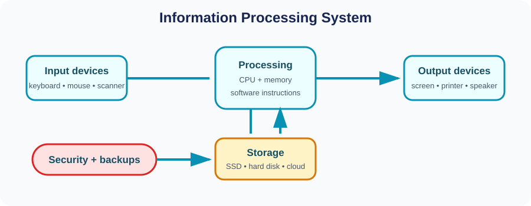

# **Basic ICT Skills Class 10 Short Notes**

[← All short notes](part-a-employability-skills-short-notes.html) · [Open chapter questions](basic-ict-skills-class-10-qa.html)

## <u>Unit 3: Basic ICT Skills</u>

**ICT (Information and Communication Technology)** includes devices, software, networks, and services used to create, store, process, transmit, and exchange information.

### Board-Paper Q&A Focus

1. **What separates a filename from its extension?**

   **Answer:** A **dot (`.`)** separates them.

   **Example:** In `notes.pdf`, `notes` is the filename and `pdf` is the extension.

2. **What is a folder?**

   **Answer:** A named location used to organise and store files or other folders.

3. **What is computer hardware?**

   **Answer:** The physical parts of a computer, such as a monitor, keyboard, CPU, printer, or hard disk.

   **Contrast:** Software is a set of instructions; hardware is the equipment that executes or stores it.

4. **Where is a project stored permanently in a computer system?**

   **Answer:** On a **secondary-storage device**, such as a hard disk or SSD.

   RAM loses its content when power is removed, while a hard disk or SSD retains data.

5. **What should a strong password contain?**

   **Answer:** A long, unique combination of **uppercase and lowercase letters, numbers, and special characters**.

   Avoid names, dates, repeated passwords, and easily guessed patterns.

6. **How can password and data security be improved?**

   **Answer:** Use unique passwords, lock the screen, install trusted updates, avoid unknown links, use antivirus protection, and keep backups.

7. **How are copy, move, and rename different?**

   **Answer:**

   - **Copy:** Creates another copy and leaves the original.
   - **Move:** Changes the file's location.
   - **Rename:** Changes the file or folder name.

> **Memory tip — LOCK:** **L**ong passwords, **O**nly trusted links, **C**urrent updates, **K**eep backups.



<p align="center"><strong>Figure 3: Input–process–storage–output model of a computer system</strong></p>

### Computer system

| Component | Function | Examples |
|---|---|---|
| **Input** | Sends data or commands into the computer | Keyboard, mouse, scanner |
| **Processing** | Performs calculations and controls work | CPU, memory |
| **Storage** | Keeps data and software | SSD, hard disk, USB drive |
| **Output** | Presents processed information | Monitor, printer, speakers |
| **Communication** | Connects computers and networks | NIC, Wi-Fi, modem |

**Hardware** is the physical equipment. **Software** is the set of instructions that controls it. An operating system manages files, memory, devices, and applications.

> **Memory tip — IPOS:** **Input, Process, Output, Store**. Remember: data goes **in**, gets **processed**, and comes **out** or is **stored**.

### Files and folders

A **file** is a named collection of stored information. A **folder** organizes files and may contain other folders.

```text
School Work
└── Information Technology
    ├── Notes
    ├── Practicals
    └── Assignments
```

Good file organization uses meaningful names, suitable folders, version information where needed, and regular deletion of duplicates. Copying creates another copy; moving transfers a file to another location; renaming changes its identifying name.

### Computer care and maintenance

- Keep ventilation areas clean and free from dust.
- Avoid liquids and food near equipment.
- Install software and operating-system updates from trusted sources.
- Remove unused applications and files safely.
- Scan the computer for malware.
- Use a UPS or safe shutdown method to reduce damage during power failure.
- Keep regular backups on a separate device or trusted cloud location.

### Security and privacy

Security protects systems and data from unauthorized access or damage. Privacy controls who may collect, view, or share personal information.

Common threats include **malware, phishing, weak passwords, spyware, hacking, spam, and accidental sharing**.

```text
Threat -> Prevention -> Detection -> Response -> Recovery
```

Safe practices:

- Use long, unique passwords and do not reuse them.
- Lock the computer when leaving it.
- Do not open unknown attachments or suspicious links.
- Verify the sender before entering personal or bank information.
- Limit application permissions.
- Keep antivirus protection and updates active.
- Back up important work.

> **Memory tip — SAFE:** **S**ecure passwords, **A**void suspicious links, **F**ix updates promptly, **E**xtra-copy important data.
