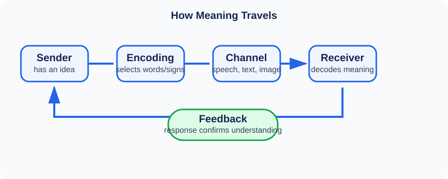

# **Communication Skills Class 10 Short Notes**

[← All short notes](part-a-employability-skills-short-notes.html) · [Open chapter questions](communication-skills-class-10-qa.html)

## <u>Unit 1: Communication Skills</u>

Communication is the purposeful exchange of ideas, information, feelings, or instructions. Effective communication occurs when the receiver interprets the message in the way intended by the sender.

### Board-Paper Q&A Focus

1. **Which element completes the communication cycle?**
   **Feedback:** The receiver's response allows the sender to check whether the message was understood correctly.
2. **How are verbal, visual, and non-verbal communication identified?**
   - **Verbal:** Spoken or written words.
   - **Visual:** Pictures, signs, charts, graphs, or symbols without relying mainly on spoken words.
   - **Non-verbal:** Facial expressions, gestures, posture, eye contact, appearance, and tone.
3. **What is an imperative sentence?**
   A sentence that gives an order, instruction, request, or command, such as **“Shut the front door.”**
4. **Which barrier is shown by noise, weak network, or buffering?**
   A **physical communication barrier**. Move to a quieter place, improve the network, or choose another channel.
5. **What is the best way to communicate one announcement to an entire class?**
   Use a suitable **mass method**, such as a notice, announcement, group email, or display, when everyone must receive the same information.
6. **What makes feedback useful?**
   It should be **specific, timely, respectful, descriptive, and focused on improvement**, not personal criticism.

### Communication cycle



<p align="center"><strong>Figure 1: The communication cycle — idea, message, channel, receiver, and feedback</strong></p>

- **Sender:** Creates the idea and sends the message.
- **Encoding:** Converts the idea into words, signs, sounds, or symbols.
- **Channel:** Medium such as speech, writing, email, telephone, or body language.
- **Receiver:** Person for whom the message is intended.
- **Decoding:** Receiver interprets the message using language, experience, and context.
- **Feedback:** Receiver responds, allowing the sender to check understanding.

### 7 C's of effective communication

| Principle | Meaning |
|---|---|
| **Clear** | Use simple language and state the main point directly. |
| **Concise** | Include necessary information without repetition. |
| **Concrete** | Use specific facts and examples. |
| **Correct** | Check facts, grammar, spelling, and pronunciation. |
| **Coherent** | Present ideas in a logical order. |
| **Complete** | Answer what, why, how, when, and where when relevant. |
| **Courteous** | Remain polite and respectful. |

> **Memory tip — 7 C's:** **Clever Cats Can Correctly Carry Complete Conversations:** Clear, Concise, Concrete, Correct, Coherent, Complete, Courteous.

### Verbal, non-verbal, and visual communication

- **Verbal communication:** Uses spoken or written words. It is direct and suitable for detailed explanations.
- **Non-verbal communication:** Uses facial expressions, gestures, posture, eye contact, touch, appearance, and tone.
- **Visual communication:** Uses signs, charts, graphs, maps, pictures, and symbols.

```text
Meaning received
      =
Words + Tone of voice + Body language + Context
```

Positive non-verbal behaviour includes sitting or standing confidently, maintaining suitable eye contact, listening without interrupting, and matching gestures with the message.

### Feedback and listening

**Feedback** is the response that completes two-way communication. It may be positive, corrective, descriptive, verbal, or non-verbal. Useful feedback is:

- Specific and related to the task.
- Timely, private when sensitive, and respectful.
- Focused on improvement rather than personal criticism.

**Active listening** involves attention, interpretation, appropriate responses, and asking questions. It is different from merely hearing sound.

### Barriers to communication

| Barrier | Example | Improvement |
|---|---|---|
| **Physical** | Noise or long distance | Reduce noise or use a suitable channel. |
| **Linguistic** | Unfamiliar vocabulary or jargon | Use simple, shared language. |
| **Cultural** | Different customs and meanings | Show respect and confirm understanding. |
| **Emotional** | Anger, fear, or nervousness | Pause, listen, and communicate calmly. |
| **Psychological** | Assumptions or poor attention | Avoid prejudice and listen actively. |

### Writing and sentence structure

A paragraph should contain one main idea supported by relevant sentences. A basic sentence contains:

```text
Subject + Verb + Object (when required)
  Riya      wrote    a clear message.
```

Important parts of speech include **noun, pronoun, adjective, verb, adverb, preposition, conjunction, interjection, and article**. Correct punctuation and short, well-organized paragraphs improve clarity.
