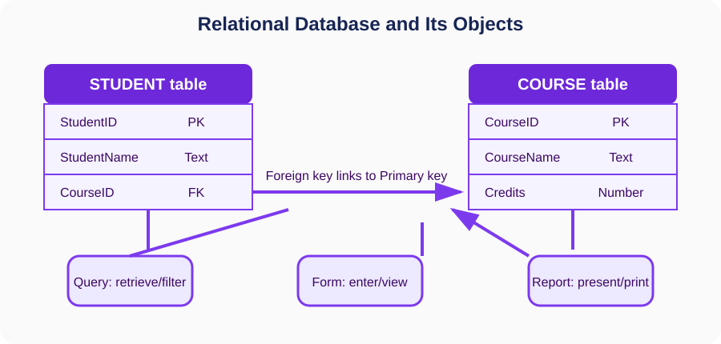

# **Database Management System Class 10 Short Notes**

[← All short notes](part-b-subject-specific-skills-short-notes.html) · [Open chapter questions](database-management-system-class-10.html)

## <u>Unit 3: Database Management System</u>

A database stores related data in an organized form. A **DBMS** provides tools to define structures, enter and update data, retrieve information, enforce rules, and protect data.

### Board-Paper Q&A Focus

1. **What is the role of each main database object?**

   **Answer:**

   - **Table:** Stores records.
   - **Query:** Retrieves, filters, sorts, calculates, or modifies data.
   - **Form:** Provides a user-friendly interface for viewing and entering records.
   - **Report:** Presents selected or summarized data in a printable layout.
2. **What is a primary key, candidate key, and alternate key?**

   **Answer:** A **primary key** uniquely identifies each record. Any field or combination that could do so is a **candidate key**; a candidate key not selected as the primary key is an **alternate key**.

   **Example:** `StudentID` may be selected as the primary key, while a unique `AdmissionNumber` remains an alternate key.

3. **What is a foreign key?**

   **Answer:** A field in one table that refers to the primary key of another table, creating a relationship.

4. **What is referential integrity?**

   **Answer:** A rule that prevents a foreign-key value from referring to a missing parent record.

   **Example:** An order cannot use `CustomerID = 50` if customer 50 does not exist in the Customer table.

5. **What is a one-to-many relationship?**

   **Answer:** One parent record can relate to many child records, but each child belongs to one parent.

   **Example:** One class has many students; each student belongs to one class.

6. **What do Update Cascade and Delete Cascade do?**

   **Answer:** **Update Cascade** changes matching foreign keys when the parent key changes. **Delete Cascade** deletes matching child records when the parent record is deleted.

7. **Which data types are commonly selected in Base?**

   **Answer:** Use **numeric** for age or quantity, **text** for names, **date/time** for dates, **boolean** for yes/no, and an image/blob type for photos.

   Choosing the correct type prevents unsuitable values and enables correct sorting and calculations.

8. **How are common SQL clauses used?**

   **Answer:** `SELECT` chooses fields, `FROM` names the table, `WHERE` filters records, and `ORDER BY` sorts results.

```sql
SELECT StudentName, Marks
FROM Student
WHERE Marks >= 50
ORDER BY Marks DESC;
```

9. **Why use forms and reports?**

   **Answer:** A form simplifies data entry and modification. A report produces a formatted, readable, and printable view; a dynamic report changes when its underlying data changes.

10. **How is the current date and time placed in a report?**

    **Answer:** Insert **Date and Time** from the report's Insert tools or use the date/time field controls available in the report designer.

```text
Primary key (parent table)
          |
          +---> Foreign key (child table)
          |          |
Referential integrity protects the connection
```

> **Memory tip — TQFR:** **T**able stores, **Q**uery finds, **F**orm enters, **R**eport presents.



<p align="center"><strong>Figure 3: Relational database tables connected by primary and foreign keys</strong></p>

### Data and information

- **Data:** Unprocessed facts, such as `Asha`, `18`, and `92`.
- **Information:** Data organized to provide meaning, such as “Asha scored 92 out of 100.”
- **Database:** Organized collection of related data.
- **DBMS:** Software that manages the database.

```text
Raw data + Context + Processing = Information
```

### Relational model

An **RDBMS** represents data as tables. Each table stores records for one type of entity.

```text
STUDENT                         COURSE
StudentID (PK)                 CourseID (PK)
Name                           CourseName
CourseID (FK) ----------------> CourseID
```

- **Entity:** A real-world object, such as student, book, or product.
- **Attribute/field:** One property, such as name or price.
- **Record/row:** One complete entity instance.
- **Table:** Collection of records with the same attributes.

### Keys and relationships

| Key | Role |
|---|---|
| **Primary key** | Uniquely identifies each record in a table. |
| **Candidate key** | Any field or field combination that could uniquely identify records. |
| **Alternate key** | Candidate key not selected as the primary key. |
| **Foreign key** | Refers to the primary key of a related table. |

Relationships connect related tables and reduce duplication:

```text
One teacher <------> One staff account       (one-to-one)
One class   <------> Many students          (one-to-many)
Many students <----> Many activities        (many-to-many)
```

Many-to-many relationships are commonly represented using a connecting table.

> **Memory tip — PK/FK:** **Primary Key = unique identity inside its own table. Foreign Key = visitor's identity linking to another table.**

### Data types

| Category | Purpose |
|---|---|
| **Text** | Names, addresses, IDs, and descriptions |
| **Numeric** | Values used in arithmetic |
| **Date/time** | Dates, times, or timestamps |
| **Currency** | Monetary values |
| **Boolean** | True/false or yes/no |
| **Binary** | Images or other binary files |

Using the correct data type prevents invalid values and makes sorting, searching, and calculations reliable.

### Database objects

- **Table:** Stores records.
- **Query:** Selects, filters, sorts, calculates, or updates data.
- **Form:** Provides a user-friendly interface for working with records.
- **Report:** Presents selected records in a formatted and printable layout.

```text
Table -> Query -> Form or Report -> User
```

### Basic SQL idea

SQL describes data to retrieve rather than how the DBMS should search for it.

```sql
SELECT StudentName, Marks
FROM Students
WHERE Marks >= 50
ORDER BY Marks DESC;
```

- `SELECT` chooses fields.
- `FROM` identifies the table.
- `WHERE` filters records.
- `ORDER BY` sorts the result.
- `INSERT`, `UPDATE`, and `DELETE` modify records.

> **Memory tip — SQL order:** **Some Friendly Wizards Order** → **SELECT, FROM, WHERE, ORDER BY**.
