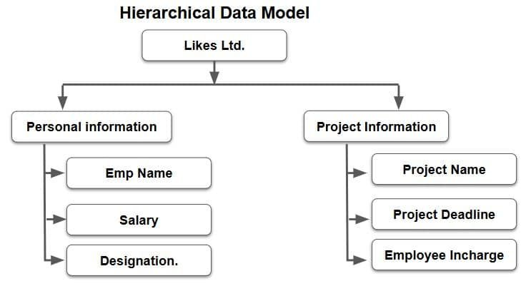
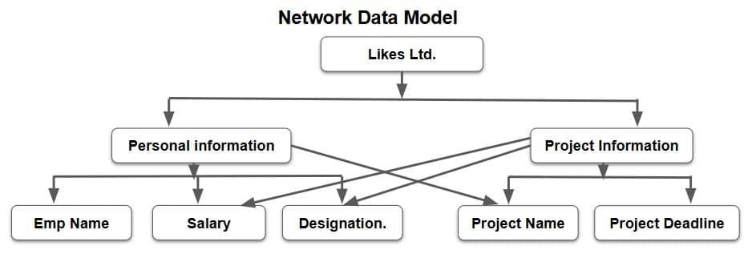
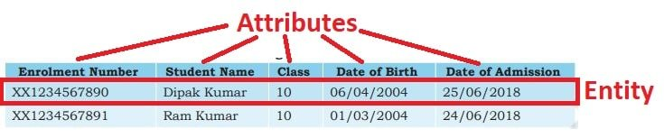
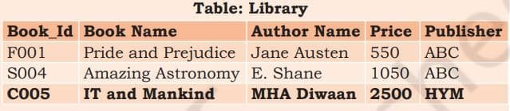

# **Database Management System Class 10 Questions and Answers**

## <u>Quick Index</u>

- [Chapter 8 Introduction to Database Management System](#chapter-8-introduction-to-database-management-system)
- [Chapter 9: Starting with LibreOffice Base](#chapter-9-starting-with-libreoffice-base)
- [Chapter 10: Working with Mutliple Tables](#chapter-10-working-with-mutliple-tables)
- [Chapter 11: Queries in Base](#chapter-11-queries-in-base)
- [Chapter 12: Forms and Reports](#chapter-12-forms-and-reports)

## <u>Chapter 8 Introduction to Database Management System</u>

### 1. What is a difference between data and information?

**Answer:**

Data – The raw facts constitute data. The facts may be related to any person, place, activity, or thing. It may be stored in the form of text, graphics, audio, or video.

Information – Information is the processed or organized form of data. If the data is not correct or accurate, the information obtained by processing such data may not be correct. For example, marks obtained by students and their roll numbers are the data, while the report card/sheet is the information.

### 2. What is a database?

**Answer:**

A database is an organized collection of data. Databases can store, retrieve, and manage large amounts of data. The database stores the information in the form of a table.

### 3. What is a database management system?

**Answer:**

A database management system (DBMS) is a software package which manages and maintains data in a database. A DBMS enables several user application programs to access the same database at the same time. It enables organizations to easily create databases for a variety of purposes. A database is a comprehensive collection of data records, files, and other items.

### 4. How is data organized in a database?

**Answer:**

There are two way to organized data in database –

- Flat File – It stores the data in a single table, and it is suitable for small amounts of data.
- Relational – It stores the data in multiple tables, and all the tables are connected to each other using a common field with the help of relationships.

### 5. What is a data module in a database? What are the different types?

**Answer:**

A database can be designed in different ways depending on what is being stored. This structure of database is known as a data model. The different data modules in the database are –

Hierarchical Data Model – In a hierarchical data model, the data is organized into a tree-like structure. The data is stored in the form of records. All these records are linked to each other at various levels.

Network Data Model – In the Network Data Model, multiple records are linked to the same master file. It is also considered an inverted tree where the master is present at the bottom of the tree and the branches contain information linked to the master.

Relational Data Model – This data model is based on the principle of setting relationships between two or more tables of the same database. It is the most commonly used database model.

### 6. What is an entity in a database?

**Answer:**

Entity is a real-world object about which information is to be stored in a database. Each entity is a collection of attributes. For example, if you want to store student information in a table, then the table heading is attributes, and the student’s single record is an entity.

### 7. What is a table in a database?

**Answer:**

A table is a collection of logically related records. It is organized as a set of columns and can have any number of rows.

### 8. What different types of keys are available in RDBMS?

**Answer:**

The different keys available in RDBMS are –

- Primary Key (PK) – A primary key is a unique value that identifies a row in a table. If the primary key is defined for any table column, it means the duplication will not be allowed.
- Candidate Key (CK) – All the field values that are eligible to be the primary key are the candidate keys for that table. Such fields can neither be left blank nor can have duplicate values.
- Alternate Key (AK) – In the table when one or two are made as primary keys. The others are the alternate keys.
- Foreign Key (FK) – By default, columns are foreign keys; foreign keys point to the primary key of another table.

### 9. What is RDBMS?

**Answer:**

RDBMS stands for Relational Database Management System, which is an upgraded version of DBMS. RDBMS stores the data in the form of a table. In RDBMS multiple tables can be linked together, and support multiple users to access the database.

### 10. What is an object in a database?

**Answer:**

An object in a database is a structure or a feature that is used to store, represent, or retrieve data. In fact, a database is a collection of objects. Various objects in a database are –

- Table
- Form
- Queries
- Report

### 11. Give the advantages of a database.

**Answer:**

Advantages of database are –

- Reduce Data Redundancy – When the same data set is stored in two or more locations, this is referred to as data redundancy. As a result, this helps in the protection of duplicate data in a database.
- Sharing of Data – Databases can share the data with multiple users at a time. There are multiple levels of authorization to access the data, and as a result, the data can only be shared with those who are permitted.
- Data Integrity – The term “data integrity” refers to the accuracy and consistency of the data in the database. Data integrity also refers to data safety.
- Data Security – You know that data is very important; databases give privileges to authorized users and allow them to access the database using a username and password.
- Privacy – A database’s privacy rule says that only authorized users are permitted to access the database. For example, if you log in to your Gmail account, then you will see your email only; you will not see any other account email.
- Backup and Recovery – Backup and recovery are handled automatically by the database management system.
- Data Consistency – Data consistency ensures the modification in the data will be the same for all the users who are accessing the database. For example, if you have a registered recovery backup ticket from the IRCTC website, then whatever changes are there, it will be the same for all the users who are trying to reserve the ticket.

## <u>Chapter 9: Starting with LibreOffice Base</u>

### 12. What is data type in database?

**Answer:**

Data types are used to define the type of data that will be stored in the database. Data types in the LibreOffice base are classified into six types.

a. Text Data Type – The text data is a combination of letters, numbers, or special characters. No arithmetic calculations can be performed on text data. Text data type categorized into three types –

- LONGVARCHAR – It is also known as the memo data type. The memo data type allows to store text data up to 64,000 characters.
- CHAR – Character data type is used to enter a fixed number of characters. It can be used for license numbers and passport numbers, as they have a fixed number of characters.
- VARCHAR – The number of bytes allocated depends on the number of characters entered by the user. For example, the address is defined as varchar (50), and if the address entered by the user is 20 characters, then only 20 bytes will be occupied in the database.

b. Numeric Data Type – Numeric data types consist of numbers. The numbers can be integers or real numbers on which any type of arithmetic calculations can be performed.

- TYNYINT
- SMALLINT
- INTEGER
- BIGINT
- NUMERIC
- DECIMAL
- FLOAT
- REAL
- DOUBLE

c. Currency Data Type – The currency data type indicates the monetary values and can be stored using currencies of various countries. For example, $100, £500, or Rs. 25.50.

d. Date Data Type – This data type is used to indicate dates and time. The date and time can be stored in various formats.

- Date – Stores the year, month, and day as it is stored in the system.
- Time – Stores the time of the day as hour, minute, and second.
- Timestamp – Stores date and time information at once.

Boolean – In the boolean data type, there can be only two values: true or false. This also can be given in multiple formats like Yes/No, True/False, On/Off.

Binary – The binary data type is used to store digitized images and sounds that come as long strings of zeros and ones.

### 13. What are the ways to create a table in LibreOffice Base?

**Answer:**

There are two different ways to create the table in the database:

- Using Design View
- Using Wizard

### 14. What is the navigation box in LibreOffice Base?

**Answer:**

The navigation box helps the records to navigate from one record to another record. The various components of the navigation box are as follows:

- Record Selector Box – This is the text box where the currently active record number is displayed.
- Navigation Buttons – These are used to scroll vertically in the table.

## <u>Chapter 10: Working with Mutliple Tables</u>

### 15. What is a relationship in a database management system?

**Answer:**

Relationship is a logical connection between two or more tables, relationship helps to check redundancy and inconsistency of data.

### 16. What is the advantage of relationships between two tables?

**Answer:**

Advantage of relationships between two tables are –

- Save time, as there is no need to enter the same data in separate tables.
- Reduce data-entry errors.
- Summarize data from related tables.

### 17. What is the file extension of LibreOffice Base?

**Answer:**

File extension for LibreOffice base is .odb.

### 18. How many types of relationships can be created in LibreOffice Base?

**Answer:**

There are three types of relationships –

- One to One – Both tables in this relationship must have primary key columns.
- One to Many or Many to One – One of the tables in this relationship must have a primary key column.
- Many to Many – The primary key column is not present in any of the tables in this relationship.

### 19. What is the difference between a transaction table and a master table in a database?

**Answer:**

If the School wants to manage student fees collection in a database, then school will create two tables, one for student details and the second for fee details; here the student details will be the master table, and fee details will be the transaction table.

### 20. What are the advantages of relationship in a database?

**Answer:**

There are various advantages of relationship tables in a database. Few of them are as given below.

- A relationship can help prevent data redundancy.
- It helps prevent missing data by keeping deleted data in a database.
- Creating relationships between tables, which helps to enter invalid data in the database.
- Any update in the master table is automatically reflected in the transaction tables.

### 21. Explain referential integrity with the help of an example.

**Answer:**

Referential integrity is used to keep data maintained, accurate, and consistent. Data in a base can be connected between two or more tables using primary key and foreign key constraints. For example, suppose there are two tables, “Student_details” and “fee_details.” In the student_details table, the fields are Grno, Student_name, Address, and phone_number (here Grno is the primary key). In the Fee_details table, fields are Grno, Fee_date, Amount (here Grno is a foreign key) Here, both have a common field “Grno.” This is known as referential Integrity.

### 22. What is referential integrity?

**Answer:**

Referential integrity is used to keep data maintained, accurate, and consistent. Data in a base can be connected between two or more tables using primary key and foreign key constraints.

Referential integrity helps to –

- If there is no connected record in the main key table, records are added to a related table.
- Changing values in a primary if there are any dependent records in the linked table
- If there are any matching linked records in an associated table, records from a primary key table are deleted.

### 23. Which option is used to maintain referential integrity?

**Answer:**

LibreOffice Base gives us following four options to maintain referential integrity.

- No action – This is the default option. This option states that a user should not be allowed to update or delete any record in the master table if any related record exists in the transaction table.
- Update cascade – This option allows the user to delete or update the referenced field, but along with it, all the related records in any of the transaction tables will also be deleted or updated.
- Set NULL – This option assigns a NULL value to all the related fields if the master record is deleted or updated.
- Set default – This option assigns any fixed default value to all the related fields if the master record is deleted or updated.

## <u>Chapter 11: Queries in Base</u>

### 24. What is a query in a database?

**Answer:**

Queries help to retrieve and display data from one or more tables in a database. This is done by giving specific search criteria to the DBMS so that we are able to view the exact information that we want.

### 25. What are the different ways to create queries in LibreOffice Base?

**Answer:**

A query can be created in three ways.

- Using a Wizard
- In Design View
- In SQL view

### 26. Consider the table given below and answer the questions that follow

**Answer:**

#### (a) Name the fields in the given table.

**Answer:**

The fields name of the table is Book_Id, Book Name, Author Name, Price, Publisher

#### (b) Which field should be made the primary key?

**Answer:**

Book_Id should be made the primary key because Book_Id uniquely identifies each record.

#### (c) Is there any alternate key in the table?

**Answer:**

The alternate key could uniquely identify records, but it is not chosen as primary key, So, Book Name can be considered as alternate key if it uniquely identifies each book.

#### (d) How is the primary key different from foreign key? Explain with examples.

**Answer:**

A primary key is a field in a table that uniquely identifies each record in the table. It means that duplication and null will not be allowed in the table. For example, Book_Id can be considered a primary key.

A foreign key is a key of another table that refers to the primary key from the first table. Foreign keys are helpful to create a relation between two tables. Example: If in the first table, the Book_Id field is defined as a primary key, then in another table, the Book_Id field will be a foreign key.

### 27. Write the SQL commands to answer the queries based on Fabric table

**Answer:**

| FabricID | Fname | Type | Disc |
| --- | --- | --- | --- |
| F001 | Shirt | Woolen | 10 |
| F002 | Suit | Cotton | 20 |
| F003 | Tunic | Cotton | 10 |
| F004 | Jeans | Denim | 5 |

#### a. Write a query for insert the following record (“F005”, “Kurta”, “Woollen”,5)

**Answer:**

insert into Fabric values (‘F005’, ‘Kurta’, ‘Woolen’,5);

#### b. Write a query to display only those fabric whose disc is more than 10

**Answer:**

select * from Fabric where Disc>10;

#### c. To display those record whose type is ‘Woolen’

**Answer:**

select * from Fabric where type = ‘Woolen’;

#### d. To modify the fabric shirt by increasing discount by 10

**Answer:**

update fabric set Disc = Disc + 10 where Fname = ‘Shirt’;

#### e. To delete the record of fabric F003 from table

**Answer:**

delete from Fabric where FabricID =‘F003’;

## <u>Chapter 12: Forms and Reports</u>

### 28. What is a form in a database?

**Answer:**

A form is an object of the database that has a user-friendly interface where data can be entered and seen in an attractive and easy-to-read format. This form is also known as a front-end application where the user can enter the data.

### 29. How many ways are there to create a form in LibreOffice base?

**Answer:**

There are two ways to create a form:

- Using a wizard
- Using the Design View

### 30. What is the Forms Control Toolbar in LibreOffice Base?

**Answer:**

This toolbar contains various controls that are related to the form. Some of the uses of the forms control toolbar are:

- Adding a calendar for the date field
- Adding text to the form
- Adding a new record using a form

### 31. What is the Records Toolbar in LibreOffice Base?

**Answer:**

The Records toolbar contains the navigation control buttons in the extreme left. With the help of these buttons, we can traverse and view the records in the file. As we move from one record to another.

### 32. What is a tooltip in LibreOffice Base?

**Answer:**

A tooltip is a small piece of text that is displayed when the mouse pointer is placed on a particular control. For example, if the mouse pointer is placed over the EventID text box, a message ‘Enter Event Identification number’ can be displayed.

### 33. What do you mean by report?

**Answer:**

Report helps to present the retrieved data in an attractive and customized manner. We can create a report based on a table or a query or both.

### 34. What are the different types of reports in LibreOffice Base?

**Answer:**

There are two types of reports in LibreOffice base –

- Dynamic Report – By default, the type of report is dynamic. That means as the field values in the base table or query change, the report will also change automatically.
- Static Report – A static report is used when we don’t want automatic updates.

### 35. Differentiate between Forms and Reports.

**Answer:**

Form

- Forms are used to store the data in a semantic way.
- Edit, delete, & modify can be easily managed.
- Auto calculation can be done easily.

Report

- Report displays the data in the presenting format
- The report can display all the records from the table.
- Edit, delete, & modification cannot be done through report
- You can take a printout with the help of the report.
