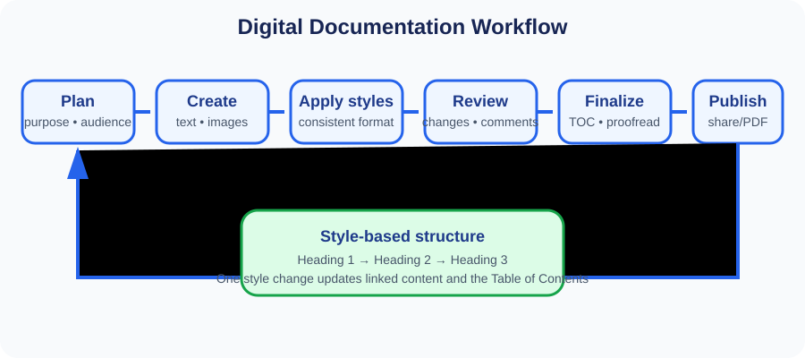

# **Digital Documentation Class 10 Short Notes**

[← All short notes](part-b-subject-specific-skills-short-notes.html) · [Open chapter questions](digital-documentation-class-10-qa.html)

## <u>Unit 1: Digital Documentation</u>

Digital documentation is the planned creation, editing, formatting, reviewing, and sharing of electronic documents using a word processor such as LibreOffice Writer.



<p align="center"><strong>Figure 1: Digital documentation workflow and heading hierarchy</strong></p>

### Styles

A **style** stores a reusable group of formatting properties. Changing the style updates every element that uses it, unlike manual formatting.

| Style category | Controls |
|---|---|
| **Paragraph** | Alignment, spacing, indentation, borders, tabs |
| **Character** | Font, size, colour, emphasis |
| **Page** | Margins, page size, header, footer, columns |
| **Frame** | Position and formatting of text frames |
| **List** | Bullet and numbering appearance |
| **Table** | Borders, background, alignment, and text layout |

Writer's Fill Format tool applies an existing style to selected content. A custom style can be created from selected formatting or modified to match house standards.

```text
Change style definition
          |
          v
All linked paragraphs update consistently
```

> **Memory tip — STYLE:** **S**elect content, **T**arget the correct style, **Y**ield consistent formatting, **L**ink to headings, **E**dit the style once.

### Images and drawing objects

Images may be inserted from a file, copied, dragged into a document, or linked to an external file.

- **Embedded image:** Stored within the document.
- **Linked image:** Uses an external image file, so the source and document should be kept together when moved.

Important operations:

| Operation | Meaning |
|---|---|
| **Resize** | Changes displayed dimensions. |
| **Crop** | Hides unwanted outer portions without necessarily changing the original image file. |
| **Filter** | Changes visual properties such as colour, blur, or sharpening. |
| **Arrange** | Controls front-to-back order. |
| **Group** | Treats several selected objects as one unit for movement or resizing. |

### Anchoring and wrapping

**Anchoring** attaches an object to a document reference:

```text
Anchor target
   ├── Page
   ├── Paragraph
   ├── Character
   └── Frame
```

**Text wrapping** controls how text flows around the object. For example, text can wrap around an image, remain above and below it, or pass in a selected direction.

Anchor controls what the object follows; wrap controls how surrounding text behaves.

> **Memory tip — A before W:** **Anchor** fixes the object's reference; **Wrap** tells text where to flow around it.

### Table of contents and headings

A **Table of Contents (TOC)** is generated from heading styles. A logical hierarchy is essential:

```text
Heading 1: Main chapter
  Heading 2: Section
    Heading 3: Subtopic
```

Avoid manually making text look like a heading. Applying actual heading styles allows Writer to create and update the TOC automatically.

### Templates and review

A **template** is a reusable starting document containing layout, styles, text, and sometimes placeholders. It saves time and enforces a consistent appearance.

- **Track Changes:** Records additions, deletions, and formatting for review.
- **Accept/Reject:** Finalizes individual or grouped tracked changes.
- **Compare Documents:** Shows differences between an original and a revised version.
- **Comments:** Add reviewer questions or explanations without changing document content.
