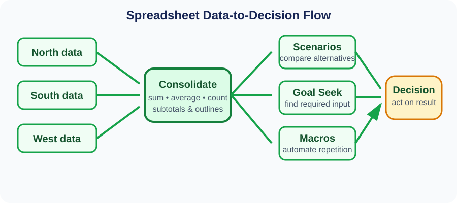

# **Electronic Spreadsheet Class 10 Short Notes**

[← All short notes](part-b-subject-specific-skills-short-notes.html) · [Open chapter questions](electronic-spreadsheet-class-10-qa.html)

## <u>Unit 2: Electronic Spreadsheet</u>

A spreadsheet organizes data in cells and supports calculations, analysis, decision-making, and charts.

### Board-Paper Q&A Focus

1. **Which feature tests different sets of input values?**
   **What-if Scenarios** or the **Scenario Manager**. Each scenario stores a set of input values for comparison.
2. **When should Goal Seek be used, and when should Solver be used?**
   Use **Goal Seek** for one changing input that must produce a target result. Use **Solver** when several changing cells, constraints, and an objective must be handled together.
3. **How is a macro recorded in LibreOffice Calc?**
   Use **Tools → Macros → Record Macro**. A macro automates repeated steps and should be run only from trusted sources.
4. **What is the default Consolidate function?**
   **Sum**. Choose **Data → Consolidate** to combine compatible ranges, and enable **Link to Source Data** when later source changes must update the result.
5. **Which feature identifies who modified shared spreadsheet content?**
   **Track Changes**, followed by Accept or Reject during review.
6. **What is an absolute hyperlink?**
   A link that stores the complete path or URL. A **relative hyperlink** stores a path relative to the current document.
7. **How are sorting and filtering different?**
   **Sorting** rearranges records by a value; **filtering** temporarily displays only records that meet a condition.
8. **Why are spreadsheet hyperlinks created?**
   To jump to another cell or sheet, open a file, open a web or email address, or quickly access a summary stored elsewhere.



<p align="center"><strong>Figure 2: Spreadsheet data-to-decision workflow</strong></p>

### Data consolidation

**Consolidation** combines values from several ranges, worksheets, or files into one summary. Operations may include sum, average, count, maximum, or minimum.

```text
North sales + South sales + West sales
                  |
                  v
           Total sales sheet
```

The source ranges should use compatible labels and organization. The consolidated result changes when the sources change only if links are enabled appropriately.

### Subtotals, grouping, and outlines

**Subtotals** calculate summary values for sorted groups. For example, records sorted by Department can produce a total sales value for each department and a grand total.

```text
Department A
  Record 1
  Record 2
  Subtotal A
Department B
  Record 3
  Subtotal B
Grand Total
```

**Grouping and outlining** hide or reveal levels of rows and columns. They improve readability without deleting detailed data.

### What-if analysis

```text
Changed input -> Calculation -> Changed result
```

| Tool | Purpose |
|---|---|
| **Scenario** | Stores different sets of input values for comparison. |
| **Multiple Operations** | Shows the effect of one or two changing variables on a formula. |
| **Goal Seek** | Finds the input value needed to produce a desired formula result. |

> **Memory tip — 3 analysis tools:** **S-M-G**: **Scenario** compares sets, **Multiple Operations** tests combinations, **Goal Seek** works backwards from a target.

Example: if a profit formula depends on units sold, Goal Seek can determine the number of units required to obtain a target profit.

### Macros

A **macro** is a recorded or programmed sequence of instructions used to automate repeated work. It can format cells, enter data, or perform a set of operations.

```text
Repeated manual steps -> Record macro -> Run one command
```

Macros may contain executable code. Therefore, enable and run macros only from trusted documents.

> **Memory tip — Macro:** **Macro = Many Actions, Recorded, Combined, Once-run**.

### Hyperlinks and data linking

A hyperlink connects a cell or text to:

- Another worksheet or cell.
- A file or folder.
- A web page.
- An email address.

A **relative link** stores the path relative to the current document, while an **absolute link** contains a complete path or URL. Relative linking is useful when a group of files is moved together while preserving the same folder structure.

### Sharing and review

**Track Changes** records who made which modification. Reviewers can accept or reject changes. **Comments** are explanatory notes attached to cells and do not normally alter the cell value.

A registered data source can connect Calc to external database data for analysis and reporting.
