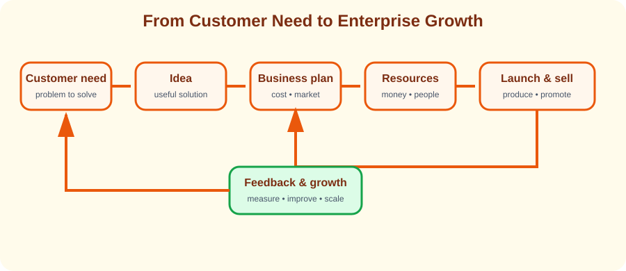

# **Entrepreneurial Skills Class 10 Short Notes**

[← All short notes](part-a-employability-skills-short-notes.html) · [Open chapter questions](entrepreneurial-skills-class-10-qa.html)

## <u>Unit 4: Entrepreneurial Skills</u>

**Entrepreneurship** is the process of identifying an opportunity, organizing resources, developing a solution, accepting reasonable risk, and operating an enterprise.



<p align="center"><strong>Figure 4: Entrepreneurship cycle — from customer need to enterprise growth</strong></p>

### Entrepreneur and enterprise

An **entrepreneur** is a person who starts and manages a venture, while an **enterprise** is the organized business or activity created to provide goods or services.

Entrepreneurs create value by solving a customer problem. The product or service is the means; the customer's need is the starting point.

### Qualities of an entrepreneur

- **Initiative:** Starts action without waiting for instructions.
- **Creativity:** Generates useful alternatives.
- **Confidence:** Makes decisions despite uncertainty.
- **Perseverance:** Continues learning after setbacks.
- **Risk-taking:** Accepts calculated, not reckless, risks.
- **Planning:** Converts a goal into tasks, time, and resources.
- **Communication:** Understands customers and works with teams.

> **Memory tip — I CREATE:** **I**nitiative, **C**reativity, **R**isk awareness, **E**ffort, **A**daptability, **T**eam leadership, **E**valuation.

### Main entrepreneurial functions

```text
Identify need
     |
Develop idea -> Arrange resources -> Produce -> Promote -> Sell
     |                                                     |
     +---------------- Measure and improve <---------------+
```

The entrepreneur studies the market, estimates costs, arranges finance, manages people, maintains quality, handles uncertainty, and reviews customer feedback.

### Types of work

| Wage employment | Self-employment | Entrepreneurship |
|---|---|---|
| Works for an employer | Works independently | Creates and grows an enterprise |
| Salary is usually fixed | Income depends on work or clients | Profit depends on enterprise performance |
| Employer controls major decisions | Person controls own work | Person organizes systems, finance, people, and risk |

### Common misconceptions

- Entrepreneurs are not necessarily born with special qualities; skills can be learned.
- Large capital is not always the only starting requirement.
- A good idea alone does not guarantee success.
- Entrepreneurship involves planning, repeated customer feedback, discipline, and risk.
- Profit is important, but customer value and responsible operation are also necessary.
