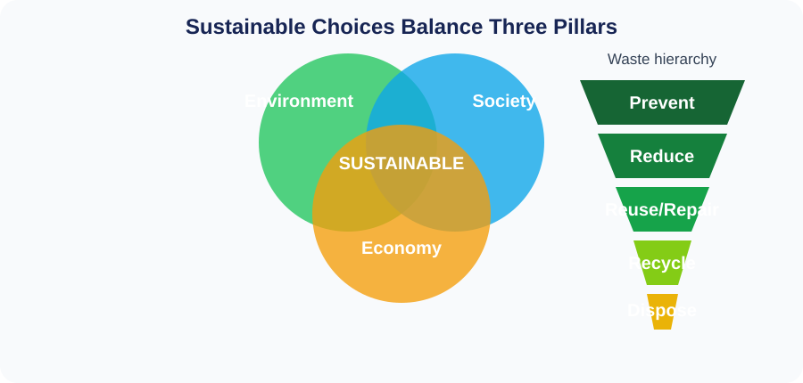

# **Green Skills Class 10 Short Notes**

[← All short notes](part-a-employability-skills-short-notes.html) · [Open chapter questions](green-skills-class-10-qa.html)

## <u>Unit 5: Green Skills</u>

**Sustainable development** meets current human needs without damaging the ability of future generations to meet theirs.



<p align="center"><strong>Figure 5: Sustainability balance and preferred waste hierarchy</strong></p>

Sustainability requires all three areas to remain in balance. Economic development without environmental and social responsibility is not sustainable.

### Major environmental challenges

| Challenge | Main effect |
|---|---|
| **Pollution** | Damages air, soil, water, ecosystems, and health. |
| **Deforestation** | Reduces biodiversity, soil stability, rainfall regulation, and carbon storage. |
| **Climate change** | Changes weather patterns and increases extreme events. |
| **Resource overuse** | Uses water, fuel, minerals, and fertile land faster than they can recover. |
| **Waste accumulation** | Fills land, pollutes environments, and wastes materials. |

### Sustainable practices

The waste hierarchy gives priority to prevention:

```text
Most preferred:   Prevent -> Reduce -> Reuse -> Repair
Then:                      Recycle -> Recover energy
Least preferred:           Safe disposal
```

Practical student actions:

- Switch off unused lights and devices.
- Use water carefully and report leaks.
- Walk, cycle, use public transport, or share rides.
- Carry reusable bags and bottles.
- Separate recyclable waste correctly.
- Buy only what is needed and maintain items to extend their life.
- Plant and protect local trees.

> **Memory tip — 3R+R:** **Refuse, Reduce, Reuse, Repair, Recycle**. First avoid waste; disposal is the last choice.

### Sustainable Development Goals

The **17 Sustainable Development Goals (SDGs)** provide a global plan for ending poverty and hunger, improving health and education, supporting equality and decent work, protecting the environment, and building peaceful cooperation.

Green skills are the knowledge and abilities needed to work in a way that conserves resources, reduces waste, controls pollution, and supports a low-impact society.
