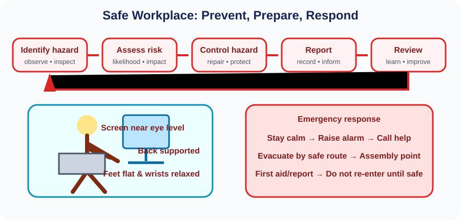

# **Healthy Safe and Secure Working Environment Class 10 Short Notes**

[← All short notes](part-b-subject-specific-skills-short-notes.html) · [Open chapter questions](maintain-healthy-safe-secure-working-environment-class-10.html)

## <u>Unit 4: Maintain a Healthy, Safe and Secure Working Environment</u>

A healthy workplace protects people, equipment, data, and the surrounding environment. Safety requires both formal rules and careful daily behaviour.

### Board-Paper Q&A Focus

1. **Give two basic fire-prevention measures.**
   Keep flammable materials away from heat, avoid overloaded sockets, switch off unused electrical equipment safely, maintain alarms/extinguishers, and keep exits clear.
2. **What should an employee do in an emergency?**
   Raise the alarm, warn others, follow the marked route to the assembly point, contact emergency services, and follow instructions. Do not use lifts during a fire or return until clearance is given.
3. **How can workplace stress be reduced?**
   Prioritize and divide tasks, take reasonable breaks, maintain good sleep and exercise, communicate workload concerns, and seek trusted or professional support.
4. **How do poor posture and screen glare affect health?**
   They may cause eye strain, headache, neck/back pain, muscle strain, and reduced concentration. Adjust screen and chair position, reduce glare, keep wrists neutral, and take short regular breaks.
5. **What are examples of workplace hazards?**
   Damaged electrical leads, trailing cables, wet floors, noise, poor lighting, awkward posture, chemicals, weak access security, and blocked exits.
6. **How should a spill or unsafe condition be handled?**
   Warn people, isolate the area when safe, use the approved cleaning or reporting procedure, and notify the responsible person. Never ignore a hazard.
7. **What makes a healthy lifestyle?**
   Balanced food, adequate sleep, regular physical activity, sufficient water, good hygiene, healthy posture, managed stress, and avoidance of harmful habits.

**Exam cue:** For a workplace situation, state the **hazard**, the **immediate safe action**, and one **preventive measure**.



<p align="center"><strong>Figure 4: Hazard-control cycle, ergonomic workstation, and emergency response</strong></p>

### Health, safety, and security policy

An organization policy states responsibilities, safety rules, reporting procedures, emergency arrangements, and training requirements.

- **Health hazard:** May cause illness.
- **Safety hazard:** May cause immediate injury or damage.
- **Security risk:** May cause theft, unauthorized access, or loss.
- **Emergency:** A serious situation needing immediate action.

### Common workplace hazards

| Hazard | Example | Control |
|---|---|---|
| **Physical** | Noise, poor lighting, exposed cables | Maintenance, guards, warning signs |
| **Electrical** | Damaged plug or overloaded socket | Switch off safely and report |
| **Slips/trips** | Wet floor or trailing wire | Clean spills and organize cables |
| **Ergonomic** | Awkward posture or repeated movement | Adjust workstation and take breaks |
| **Fire** | Flammable material near heat | Storage, alarms, and safe evacuation |
| **Information** | Weak password or unattended screen | Access control and screen locking |

### Ergonomics

**Ergonomics** fits the workplace to the worker so that tasks can be completed safely and efficiently.

```text
Screen: top near eye level
Back: supported by chair
Forearms/wrists: relaxed and supported
Feet: flat on floor or footrest
Position: change regularly
```

Long periods in one posture can lead to muscle strain, back pain, wrist injury, or eye discomfort. Good practices include appropriate seating, neutral wrists, proper screen distance, reduced glare, and short regular breaks.

> **Memory tip — SAFE workstation:** **S**creen at eye level, **A**ligned back and wrists, **F**eet supported, **E**xercise or take breaks.

### Air, water, waste, and quality

Workplace quality includes clean drinking water, proper ventilation, controlled noise, suitable lighting, hygienic surroundings, and responsible waste disposal. Electrical waste, batteries, chemicals, and confidential paper need suitable separate handling.

### Accident and emergency response

```text
Stay calm -> Warn others -> Protect from danger -> Contact help
            -> Evacuate -> First aid -> Report -> Prevent recurrence
```

During an evacuation:

1. Follow the alarm and trained wardens.
2. Use marked escape routes and stairs.
3. Do not collect belongings or use lifts during a fire.
4. Move to the assembly point.
5. Report missing persons.
6. Return only after official clearance.

### Fire extinguisher awareness

An extinguisher works only when the correct type is selected and used by a trained person. The major extinguisher agents include water, foam, CO₂, dry powder, and wet chemical; each suits different fire types.

```text
If the fire is unsafe or smoke is spreading:
Raise alarm -> Evacuate -> Call emergency services
```

Do not fight a fire when an exit is not safely available, smoke prevents visibility, or the correct equipment and training are unavailable.

> **Memory tip — A-R-C:** **Alarm, Route, Contact help**. Raise the alarm, follow the safe route, and contact emergency services.

### First aid and CPR

**First aid** is immediate assistance given until professional medical care arrives. First aiders should protect themselves, check danger, call emergency services, and provide only the care for which they are trained.

**CPR (Cardiopulmonary Resuscitation)** supports a person whose heart and normal breathing have stopped. Its steps, compression rate, and AED use should follow current recognized training. In an emergency, call the local emergency service and follow trained dispatcher instructions.
