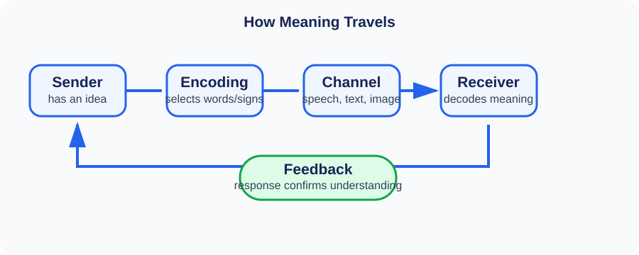
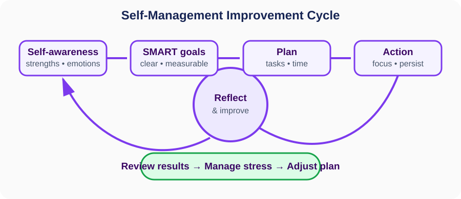
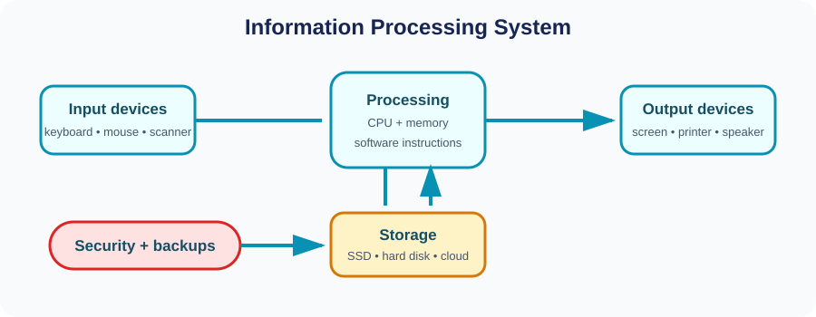
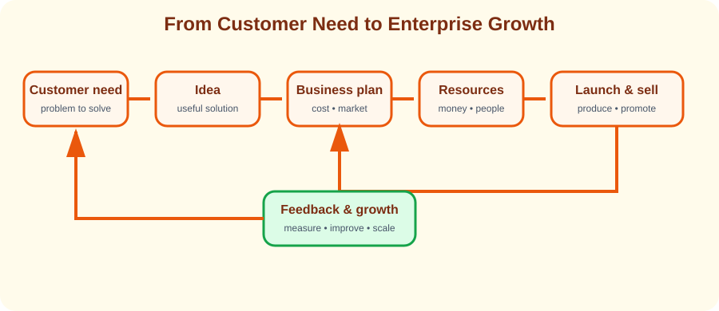
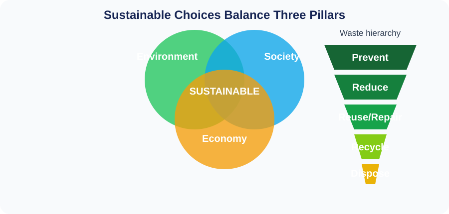

# **Part A: Employability Skills — Concept Notes**

## <u>Quick Index</u>

- [Unit 1: Communication Skills](#unit-1-communication-skills)
- [Unit 2: Self-Management Skills](#unit-2-self-management-skills)
- [Unit 3: Basic ICT Skills](#unit-3-basic-ict-skills)
- [Unit 4: Entrepreneurial Skills](#unit-4-entrepreneurial-skills)
- [Unit 5: Green Skills](#unit-5-green-skills)

## <u>Unit 1: Communication Skills</u>

Communication is the purposeful exchange of ideas, information, feelings, or instructions. Effective communication occurs when the receiver interprets the message in the way intended by the sender.

### Communication cycle



<p align="center"><strong>Figure 1: The communication cycle — idea, message, channel, receiver, and feedback</strong></p>

- **Sender:** Creates the idea and sends the message.
- **Encoding:** Converts the idea into words, signs, sounds, or symbols.
- **Channel:** Medium such as speech, writing, email, telephone, or body language.
- **Receiver:** Person for whom the message is intended.
- **Decoding:** Receiver interprets the message using language, experience, and context.
- **Feedback:** Receiver responds, allowing the sender to check understanding.

### 7 C's of effective communication

| Principle | Meaning |
|---|---|
| **Clear** | Use simple language and state the main point directly. |
| **Concise** | Include necessary information without repetition. |
| **Concrete** | Use specific facts and examples. |
| **Correct** | Check facts, grammar, spelling, and pronunciation. |
| **Coherent** | Present ideas in a logical order. |
| **Complete** | Answer what, why, how, when, and where when relevant. |
| **Courteous** | Remain polite and respectful. |

> **Memory tip — 7 C's:** **Clever Cats Can Correctly Carry Complete Conversations:** Clear, Concise, Concrete, Correct, Coherent, Complete, Courteous.

### Verbal, non-verbal, and visual communication

- **Verbal communication:** Uses spoken or written words. It is direct and suitable for detailed explanations.
- **Non-verbal communication:** Uses facial expressions, gestures, posture, eye contact, touch, appearance, and tone.
- **Visual communication:** Uses signs, charts, graphs, maps, pictures, and symbols.

```text
Meaning received
      =
Words + Tone of voice + Body language + Context
```

Positive non-verbal behaviour includes sitting or standing confidently, maintaining suitable eye contact, listening without interrupting, and matching gestures with the message.

### Feedback and listening

**Feedback** is the response that completes two-way communication. It may be positive, corrective, descriptive, verbal, or non-verbal. Useful feedback is:

- Specific and related to the task.
- Timely, private when sensitive, and respectful.
- Focused on improvement rather than personal criticism.

**Active listening** involves attention, interpretation, appropriate responses, and asking questions. It is different from merely hearing sound.

### Barriers to communication

| Barrier | Example | Improvement |
|---|---|---|
| **Physical** | Noise or long distance | Reduce noise or use a suitable channel. |
| **Linguistic** | Unfamiliar vocabulary or jargon | Use simple, shared language. |
| **Cultural** | Different customs and meanings | Show respect and confirm understanding. |
| **Emotional** | Anger, fear, or nervousness | Pause, listen, and communicate calmly. |
| **Psychological** | Assumptions or poor attention | Avoid prejudice and listen actively. |

### Writing and sentence structure

A paragraph should contain one main idea supported by relevant sentences. A basic sentence contains:

```text
Subject + Verb + Object (when required)
  Riya      wrote    a clear message.
```

Important parts of speech include **noun, pronoun, adjective, verb, adverb, preposition, conjunction, interjection, and article**. Correct punctuation and short, well-organized paragraphs improve clarity.

---

## <u>Unit 2: Self-Management Skills</u>

Self-management is the ability to regulate emotions, behaviour, effort, and time while working towards personal and professional goals.



<p align="center"><strong>Figure 2: Self-management improvement cycle</strong></p>

### Self-awareness

**Self-awareness** means understanding your interests, values, strengths, weaknesses, emotions, and typical reactions.

- **Strength:** An ability or quality in which you perform well.
- **Weakness:** An area requiring support or improvement.
- Strengths can be identified from success, enjoyment, and positive feedback.
- Weaknesses can be identified from repeated difficulty and constructive feedback.

Honest self-analysis is not self-criticism. Its purpose is to build a realistic improvement plan.

### Stress and stress management

**Stress** is the physical and emotional response to pressure or a perceived demand. A limited amount of stress may improve alertness, but excessive stress can affect concentration, sleep, health, and performance.

```text
Stressors -> Response -> Warning signs -> Action -> Recovery
```

Common warning signs include headaches, irritability, poor sleep, loss of concentration, anxiety, and tiredness.

Useful stress-management methods:

1. Recognize the warning signs.
2. Identify the cause instead of only treating symptoms.
3. Divide a large task into smaller tasks.
4. Exercise, rest, eat regularly, and sleep adequately.
5. Use relaxation or breathing exercises.
6. Speak to a trusted person or seek professional help when stress is severe or persistent.

### Motivation

**Motivation** is the drive that starts and maintains goal-directed action.

| Type | Source | Example |
|---|---|---|
| **Internal** | Personal interest or satisfaction | Learning because the topic is enjoyable. |
| **External** | Reward or recognition | Working for marks, money, or praise. |

Self-motivated learners show commitment, focus, confidence, and willingness to continue after setbacks. External rewards may start an action, but internal motivation is often more lasting.

### SMART goals

```text
Specific -> Measurable -> Achievable -> Realistic -> Time-bound
```

> **Memory tip — SMART:** **Sensible Maps Always Reach Targets:** Specific, Measurable, Achievable, Realistic, Time-bound.

For example, “I will revise the DBMS unit for 30 minutes every day for 14 days and solve one worksheet on each topic” is more useful than “I will study harder.”

### Time management

Time management means using available time according to importance and deadlines.

```text
Plan -> Prioritize -> Schedule -> Work -> Review -> Improve
```

An important decision is to distinguish:

- **Urgent and important:** Do first.
- **Important but not urgent:** Schedule properly.
- **Urgent but less important:** Delegate or limit where possible.
- **Neither:** Avoid or postpone.

---

## <u>Unit 3: Basic ICT Skills</u>

**ICT (Information and Communication Technology)** includes devices, software, networks, and services used to create, store, process, transmit, and exchange information.



<p align="center"><strong>Figure 3: Input–process–storage–output model of a computer system</strong></p>

### Computer system

| Component | Function | Examples |
|---|---|---|
| **Input** | Sends data or commands into the computer | Keyboard, mouse, scanner |
| **Processing** | Performs calculations and controls work | CPU, memory |
| **Storage** | Keeps data and software | SSD, hard disk, USB drive |
| **Output** | Presents processed information | Monitor, printer, speakers |
| **Communication** | Connects computers and networks | NIC, Wi-Fi, modem |

**Hardware** is the physical equipment. **Software** is the set of instructions that controls it. An operating system manages files, memory, devices, and applications.

> **Memory tip — IPOS:** **Input, Process, Output, Store**. Remember: data goes **in**, gets **processed**, and comes **out** or is **stored**.

### Files and folders

A **file** is a named collection of stored information. A **folder** organizes files and may contain other folders.

```text
School Work
└── Information Technology
    ├── Notes
    ├── Practicals
    └── Assignments
```

Good file organization uses meaningful names, suitable folders, version information where needed, and regular deletion of duplicates. Copying creates another copy; moving transfers a file to another location; renaming changes its identifying name.

### Computer care and maintenance

- Keep ventilation areas clean and free from dust.
- Avoid liquids and food near equipment.
- Install software and operating-system updates from trusted sources.
- Remove unused applications and files safely.
- Scan the computer for malware.
- Use a UPS or safe shutdown method to reduce damage during power failure.
- Keep regular backups on a separate device or trusted cloud location.

### Security and privacy

Security protects systems and data from unauthorized access or damage. Privacy controls who may collect, view, or share personal information.

Common threats include **malware, phishing, weak passwords, spyware, hacking, spam, and accidental sharing**.

```text
Threat -> Prevention -> Detection -> Response -> Recovery
```

Safe practices:

- Use long, unique passwords and do not reuse them.
- Lock the computer when leaving it.
- Do not open unknown attachments or suspicious links.
- Verify the sender before entering personal or bank information.
- Limit application permissions.
- Keep antivirus protection and updates active.
- Back up important work.

> **Memory tip — SAFE:** **S**ecure passwords, **A**void suspicious links, **F**ix updates promptly, **E**xtra-copy important data.

---

## <u>Unit 4: Entrepreneurial Skills</u>

**Entrepreneurship** is the process of identifying an opportunity, organizing resources, developing a solution, accepting reasonable risk, and operating an enterprise.



<p align="center"><strong>Figure 4: Entrepreneurship cycle — from customer need to enterprise growth</strong></p>

### Entrepreneur and enterprise

An **entrepreneur** is a person who starts and manages a venture, while an **enterprise** is the organized business or activity created to provide goods or services.

Entrepreneurs create value by solving a customer problem. The product or service is the means; the customer's need is the starting point.

### Qualities of an entrepreneur

- **Initiative:** Starts action without waiting for instructions.
- **Creativity:** Generates useful alternatives.
- **Confidence:** Makes decisions despite uncertainty.
- **Perseverance:** Continues learning after setbacks.
- **Risk-taking:** Accepts calculated, not reckless, risks.
- **Planning:** Converts a goal into tasks, time, and resources.
- **Communication:** Understands customers and works with teams.

> **Memory tip — I CREATE:** **I**nitiative, **C**reativity, **R**isk awareness, **E**ffort, **A**daptability, **T**eam leadership, **E**valuation.

### Main entrepreneurial functions

```text
Identify need
     |
Develop idea -> Arrange resources -> Produce -> Promote -> Sell
     |                                                     |
     +---------------- Measure and improve <---------------+
```

The entrepreneur studies the market, estimates costs, arranges finance, manages people, maintains quality, handles uncertainty, and reviews customer feedback.

### Types of work

| Wage employment | Self-employment | Entrepreneurship |
|---|---|---|
| Works for an employer | Works independently | Creates and grows an enterprise |
| Salary is usually fixed | Income depends on work or clients | Profit depends on enterprise performance |
| Employer controls major decisions | Person controls own work | Person organizes systems, finance, people, and risk |

### Common misconceptions

- Entrepreneurs are not necessarily born with special qualities; skills can be learned.
- Large capital is not always the only starting requirement.
- A good idea alone does not guarantee success.
- Entrepreneurship involves planning, repeated customer feedback, discipline, and risk.
- Profit is important, but customer value and responsible operation are also necessary.

---

## <u>Unit 5: Green Skills</u>

**Sustainable development** meets current human needs without damaging the ability of future generations to meet theirs.



<p align="center"><strong>Figure 5: Sustainability balance and preferred waste hierarchy</strong></p>

Sustainability requires all three areas to remain in balance. Economic development without environmental and social responsibility is not sustainable.

### Major environmental challenges

| Challenge | Main effect |
|---|---|
| **Pollution** | Damages air, soil, water, ecosystems, and health. |
| **Deforestation** | Reduces biodiversity, soil stability, rainfall regulation, and carbon storage. |
| **Climate change** | Changes weather patterns and increases extreme events. |
| **Resource overuse** | Uses water, fuel, minerals, and fertile land faster than they can recover. |
| **Waste accumulation** | Fills land, pollutes environments, and wastes materials. |

### Sustainable practices

The waste hierarchy gives priority to prevention:

```text
Most preferred:   Prevent -> Reduce -> Reuse -> Repair
Then:                      Recycle -> Recover energy
Least preferred:           Safe disposal
```

Practical student actions:

- Switch off unused lights and devices.
- Use water carefully and report leaks.
- Walk, cycle, use public transport, or share rides.
- Carry reusable bags and bottles.
- Separate recyclable waste correctly.
- Buy only what is needed and maintain items to extend their life.
- Plant and protect local trees.

> **Memory tip — 3R+R:** **Refuse, Reduce, Reuse, Repair, Recycle**. First avoid waste; disposal is the last choice.

### Sustainable Development Goals

The **17 Sustainable Development Goals (SDGs)** provide a global plan for ending poverty and hunger, improving health and education, supporting equality and decent work, protecting the environment, and building peaceful cooperation.

Green skills are the knowledge and abilities needed to work in a way that conserves resources, reduces waste, controls pollution, and supports a low-impact society.
