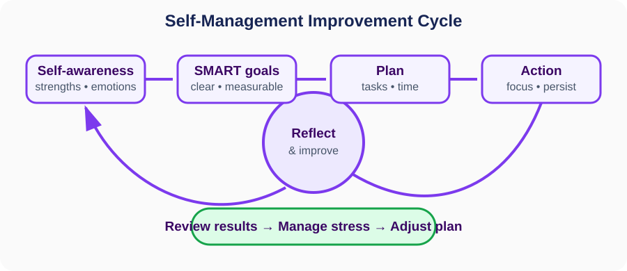

# **Self-Management Skills Class 10 Short Notes**

[← All short notes](part-a-employability-skills-short-notes.html) · [Open chapter questions](self-management-skills-class-10-qa.html)

## <u>Unit 2: Self-Management Skills</u>

Self-management is the ability to regulate emotions, behaviour, effort, and time while working towards personal and professional goals.

### Board-Paper Q&A Focus

1. **What is self-management?**
   It is the ability to control one's behaviour, emotions, effort, and time while achieving goals.
2. **What is emotional intelligence or emotional self-awareness?**
   The ability to identify, understand, regulate, and use one's own emotions and respond suitably to the emotions of others.
3. **Why should a big goal be divided into smaller parts?**
   Smaller parts make the goal more **achievable** because progress can be planned, measured, and reviewed regularly.
4. **What does SMART stand for?**
   **Specific, Measurable, Achievable, Realistic, and Time-bound.**
5. **What is motivation?**
   It is the driving force that starts, directs, and maintains effort towards a goal. It may be **internal** or **external**.
6. **Define time management.**
   Planning and organising available time so that tasks are completed according to priority and deadline.
7. **Give common ways to manage stress.**
   Divide work into smaller tasks, practise breathing or relaxation, take regular exercise, sleep adequately, maintain a routine, and talk to a trusted person.

**Exam cue:** If a situation mentions setting daily targets, rising early, revising regularly, or completing planned work, it usually tests **self-management or time management**.



<p align="center"><strong>Figure 2: Self-management improvement cycle</strong></p>

### Self-awareness

**Self-awareness** means understanding your interests, values, strengths, weaknesses, emotions, and typical reactions.

- **Strength:** An ability or quality in which you perform well.
- **Weakness:** An area requiring support or improvement.
- Strengths can be identified from success, enjoyment, and positive feedback.
- Weaknesses can be identified from repeated difficulty and constructive feedback.

Honest self-analysis is not self-criticism. Its purpose is to build a realistic improvement plan.

### Stress and stress management

**Stress** is the physical and emotional response to pressure or a perceived demand. A limited amount of stress may improve alertness, but excessive stress can affect concentration, sleep, health, and performance.

```text
Stressors -> Response -> Warning signs -> Action -> Recovery
```

Common warning signs include headaches, irritability, poor sleep, loss of concentration, anxiety, and tiredness.

Useful stress-management methods:

1. Recognize the warning signs.
2. Identify the cause instead of only treating symptoms.
3. Divide a large task into smaller tasks.
4. Exercise, rest, eat regularly, and sleep adequately.
5. Use relaxation or breathing exercises.
6. Speak to a trusted person or seek professional help when stress is severe or persistent.

### Motivation

**Motivation** is the drive that starts and maintains goal-directed action.

| Type | Source | Example |
|---|---|---|
| **Internal** | Personal interest or satisfaction | Learning because the topic is enjoyable. |
| **External** | Reward or recognition | Working for marks, money, or praise. |

Self-motivated learners show commitment, focus, confidence, and willingness to continue after setbacks. External rewards may start an action, but internal motivation is often more lasting.

### SMART goals

```text
Specific -> Measurable -> Achievable -> Realistic -> Time-bound
```

> **Memory tip — SMART:** **Sensible Maps Always Reach Targets:** Specific, Measurable, Achievable, Realistic, Time-bound.

For example, “I will revise the DBMS unit for 30 minutes every day for 14 days and solve one worksheet on each topic” is more useful than “I will study harder.”

### Time management

Time management means using available time according to importance and deadlines.

```text
Plan -> Prioritize -> Schedule -> Work -> Review -> Improve
```

An important decision is to distinguish:

- **Urgent and important:** Do first.
- **Important but not urgent:** Schedule properly.
- **Urgent but less important:** Delegate or limit where possible.
- **Neither:** Avoid or postpone.
